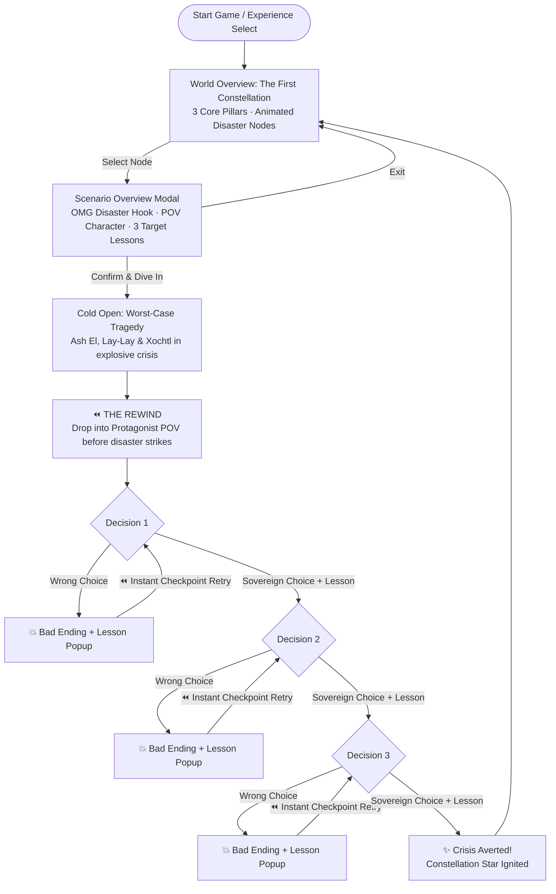

# Story Structure — Episodic Constellation & Rewind Framework

Instead of forcing players through a single long, linear slog before learning a lesson, **Get Rich Together (DAOCUBATOR)** is structured around an interactive **World Overview Constellation** and gripping, digestible **Episodic Micro-Dramas** powered by a **Worst-Case Hook + Rewind + 3 Checkpointed Decisions** loop.

## 1. The World Overview ("The First Constellation")

Players begin at the **World Overview Constellation**, inspired by Asya's *Primordia / First Constellation* blueprint:
- Shows **3 Core Categories of Lessons**:
  1. **Keys & Sovereignty (Crypto Basis & OpSec)**
  2. **Collaboration & Co-op (Winning Together)**
  3. **Make & Enforce Agreements (Law, Structure & Treasury)**
- Glowing, animated constellation stars orbit each theme.
- Clicking a star opens a **Scenario Overview Modal** showcasing an **"OMG Disaster" Hook** (e.g., *"$60,000 Sent to the Void & Stranded in Brazil"*, *"The Jealous Gatekeeper Freezes the Lisbon Showcase"*, *"Served in the Help Chat"*). Players can exit to keep exploring or confirm to jump straight into fixing the disaster.

## 2. The Episodic Rewind Loop (~5 Minutes per Episode)

Every episode follows a tight 4-beat structure:
1. **The Hook (The Tragedy):** Drops the player directly into the nightmare outcome—**Ash El**, **Lay-Lay**, and **Xochtl** in an explosive fight as the community treasury vanishes or the project shatters.
2. **The Rewind (`⏪`):** Rewinds the timeline to the critical days before disaster strikes.
3. **Three Checkpointed Decisions (`D1 → D2 → D3`):**
   - Each wrong choice immediately triggers a punchy, memorable **Bad Ending**, unlocks the **Lesson Learned** popup, and offers a **1-click Checkpoint Rewind** right back to *that exact decision* (so players learn fast and never have to replay all 3 choices from scratch).
   - Each right choice demonstrates the sovereign solution, unlocks the **Lesson Learned**, and advances to the next decision.
4. **Resolution:** Heals the timeline, lights up the star on the World Overview Constellation, and returns the player to choose their next episode.

## 3. Playable Episodes in the Constellation

| Episode | Constellation Pillar | POV Protagonist | OMG Disaster Hook | 3 Checkpointed Decisions & Lessons |
|---------|----------------------|-----------------|-------------------|------------------------------------|
| **Ep 1: No Keys, No Cheese** | Keys & Sovereignty | **Ash El** (The Creator) | Stranded on the Brazil sanctuary trip while $60,000 vanishes into a dead address and Lay-Lay locks the multisig. | **D1:** Rotate leaked text-file keys on-chain & set 2-of-3 multisig ([[No Keys No Cheese]], [[Credential Hygiene]]) **D2:** Vet the incoming DAO co-admin before voting ([[Vetting DAO Administrators]]) **D3:** Send a $1 test transaction before wiring $60,000 ([[The One Dollar Test Transaction]]) |
| **Ep 2: The Lisbon Refusal** | Collaboration & Co-op | **Xochtl** & **Ash El** | Hours before the Lisbon presentation, Lay-Lay freezes Ash El's game payout out of jealousy, threatening to detonate the showcase. | **D1:** Separate admin ops from subjective creative veto ([[Creator vs Administrator Gatekeeping]]) **D2:** Submit the deliverable under a neutral avatar to prove bias on-chain ([[Co-op Solidarity]]) **D3:** Enact rotating stewardship & rest to prevent creator burnout ([[Burnout and Identity Fusion]], [[Voter Apathy and Delegation]]) |
| **Ep 3: Blood, Cacao & Paper** | Make & Enforce Agreements | **Ash El** & **Xochtl** | A departing member claims 50% dead equity, a 360 deal traps the masters, and a regulator serves the DAO via Discord chat. | **D1:** Reject "handshake vibes" for 4-year vesting + 1-year cliff ([[Make and Enforce Agreements]], [[The Equal Split Trap]], [[Vesting and Dead Equity]]) **D2:** Form a Swiss Verein / Co-op legal wrapper ([[The Partnership Trap]]) **D3:** Strike 360 cross-collateralization & build a 50% stablecoin barbell ([[Predatory Recoupment]], [[Treasury Death Spiral]]) |
| **Ep 4: One Tired Click Drained the Apothecary** | Perspective Shift (Admin & Defense) | **Lay-Lay** (The Administrator) | Overwhelmed at 1:14 a.m., Lay-Lay gets baited by a predatory whale and a spoofed wallet popup that drains the apothecary treasury. | **D1:** Refuse unilateral "weekend yield" temptations & keep co-op multisig transparency ([[Governance Capture]]) **D2:** Verify raw hex on the hardware screen & run a $1 test batch ([[Verify the Hex]], [[Ice Phishing]]) **D3:** Use a 48-hour time-lock & community delegation to defeat a flash-loan whale attack ([[Flash Loans and Time-locks]]) |

*(Note: The original 5-chapter "90-Day Founder Marathon" remains accessible from the Constellation screen as Legacy Marathon Mode.)*
